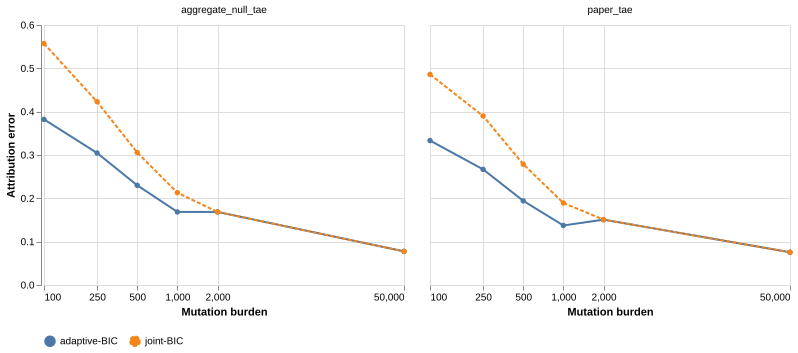

## Results







[Interactive chart](results/interactive.html).
[Paired differences and intervals](results/paired-differences.tsv).
[Results by condition](results/conditions.tsv).
[Results by cancer distribution](results/cancers.tsv).

## Search policy

Joint-background BIC starts from the best feasible single component through 1,000 mutations.
It compares all one-component additions and removals and accepts the largest BIC improvement.
Above 1,000 mutations, it retains the preceding full-model initialization and search.
Fixed-background BIC, block selection, and AICc retain their preceding search.
The likelihood optimizer, signature reference, and BIC penalty remain the same.

The threshold follows the tuning panel and does not represent a biological boundary.
Both searches stop at a local subset optimum.
Neither search guarantees the globally best subset or correct biological attribution.
If no single component covers all observed channels, the algorithm uses the full-model start.

## Separate exploration, tuning, and validation

Exploration uses 64 previously examined profiles at 100 mutations.
The first screen compares AICc, model-space penalties, and sparse NNLS variants.
The second screen tests forward search and stronger model-space penalties.
[First pilot](pilot/summary.tsv) and [second pilot](pilot2/summary.tsv) retain all candidate results.

The fresh tuning panel contains 768 profiles across six burdens and four conditions.
It uses four empirical exposure draws from each of eight cancer distributions.
Its seed is `202610291`.
Forward BIC improves both mean error metrics in every condition through 1,000 mutations.
Higher burdens show condition-specific regressions, which motivates the retained high-burden path.

[The frozen selection record](selection.json) specifies the rule before validation starts.
Validation uses seed `202610292` and eight exposure draws per cancer distribution.
It contains 1,536 profiles and 3,072 paired fits.
Every profile receives both the preceding and proposed algorithms.
The algorithm receives counts and signatures, without a cancer label or exposure prior.

The primary gate requires lower error at each low burden under both metrics.
Every paired 95% interval must have an upper bound below zero.
The high-burden gate requires exact equality of all fitted weights above 1,000 mutations.
The sensitivity panel uses seed `202610293` and removes the ten-mutation cutoff from generating truth.
It contains 256 profiles at 50 and 100 mutations.

## Metrics and uncertainty

`aggregate_null_tae` measures unthresholded known-signature error plus aggregate background-mass error, divided by two.
`paper_tae` applies the ten-mutation reporting threshold and compares known estimates against complete generating-signature truth.
The methods use the same metric implementation and identical inputs.

Paired bootstrap intervals resample exposure draws within each cancer distribution 4,000 times.
Each draw retains its four matched conditions.
The analysis keeps all eight cancer distributions in each bootstrap replicate.
These intervals describe simulation variation within those distributions.
They do not represent clinical population uncertainty.

## Evidence limits

A separate check uses the package's bundled COSMICv3 reference on 128 validation profiles.
It selects the first exposure draw in every cancer, condition, and low-burden cell without further tuning.
Both mean errors decrease at all four tested low burdens.
[Bundled-reference results](bundled-reference/summary.tsv) retain the separate estimates.

The generator uses empirical exposure distributions from the pinned SigFitTest inputs.
It generates with COSMIC v3.3.1 and fits COSMIC v3, preserving the preceding benchmark's reference mismatch.
The conditions are clean, out-of-reference signatures, uniform background, and substitution-specific background.
Each non-clean condition contributes 20% additional mass.
The primary panel removes generating components below ten expected mutations.
The sensitivity panel tests the effect of that truth cutoff.

Fresh draws from these distributions do not constitute independent patient validation.
The panel does not establish performance for every reference catalog or mutation spectrum.
The comparison addresses the preceding MutaGene default.
It does not establish superiority over external tools on these fresh profiles.

## Reproduce

Restore the ten upstream inputs from SigFitTest commit `e94bac6e9b04fb13500d1904b5e0e8d58b00d8ad`.
The generator verifies their hashes against the preceding benchmark provenance.
Use an isolated checkout and the recorded source snapshots for the historical comparator.
Existing output directories prevent accidental replacement of benchmark results.

```sh
cp analysis/low-burden-2026/baseline-source/mutagene/signatures/sparse.py \
  mutagene/signatures/sparse.py
python analysis/low-burden-2026/pilot.py
python analysis/low-burden-2026/pilot2.py
python analysis/low-burden-2026/tune.py
# Restore the frozen selection.json before running validation.
python analysis/low-burden-2026/validate.py validation
python analysis/low-burden-2026/validate.py sensitivity
python analysis/low-burden-2026/summarize.py
quarto render analysis/low-burden-2026/report.qmd
```

[Validation gates](results/gates.json).

## Implementation checks

The production implementation exactly reproduces all 1,536 validation estimates and all 256 sensitivity estimates.
Every refit satisfies the existing likelihood optimality-gap tolerance.
The full suite passes 529 tests, including eleven new search regressions.
Tests cover the threshold, high-burden identity, disjoint support, and unchanged fixed, block, and AICc policies.
Strict documentation checks and source-distribution and wheel builds pass.
The clean installed wheel passes the offline demo, web assets, source-identity check, and low/high search-path checks.
[Implementation verification](results/implementation-verification.json) records exact-match counts and maximum refit gaps.
[Validation logs](results/validation.json) record the package checks and software versions.
[Artifact manifest](artifact-manifest.json) records the final evidence hashes.

```sh
python analysis/low-burden-2026/verify_artifacts.py
```
