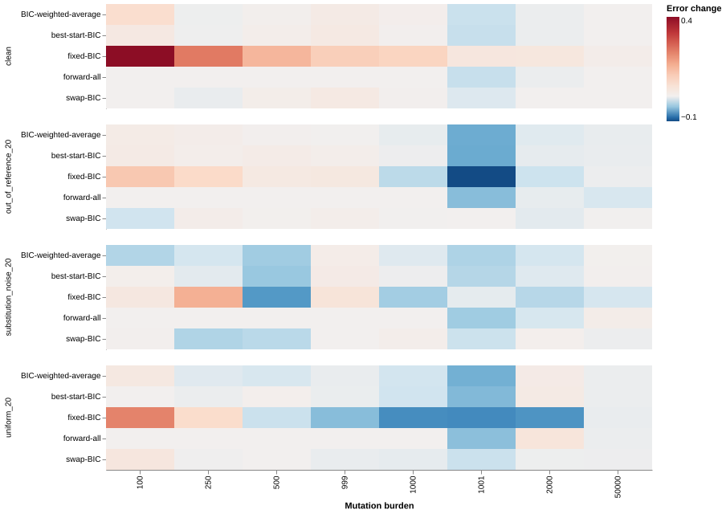

## Findings





The low-burden range contains 100, 250, 500, 999, and 1,000 mutations.
The high-burden range contains 1,001, 2,000, and 50,000 mutations.
These summaries weight each listed burden equally.

## Scenario comparisons



Negative error changes favor the candidate.
Positive changes indicate regressions.
[Interactive chart](results/interactive.html).
[All condition-level results](results/conditions.tsv).
[Results by cancer distribution](results/cancers.tsv).
[Paired differences](results/paired-differences.tsv).
[Descriptive intervals](results/intervals.tsv).

## Independent transition experiment

For `1000 < N < 2000`, the candidate uses `(1 - alpha) * forward + alpha * current`.
Here, `alpha = (N - 1000) / 1000`.
At other burdens, it returns the current estimate exactly.
This changes the transition between searches without altering the low-burden or high-burden endpoint rules.
Subset selection can still change when counts change.

The rule remains fixed before this experiment generates results.
Seed `202610299` supplies 512 fresh profiles from the same eight cancer distributions and four conditions.
The panel tests 1,000, 1,001, 1,250, 1,500, 1,750, 1,999, 2,000, and 50,000 mutations.
Each method uses identical profiles.



[Transition specification](transition/specification.json).
[Transition intervals](results/transition-intervals.tsv).
[Condition-level differences](results/transition-cell-differences.tsv).
[Endpoint verification](results/transition-gates.json).

The blended weights form a valid probability mixture.
They do not constitute a constrained MLE refit or a BIC-selected subset.
These results support further development of the transition candidate, without establishing superiority for every scenario or patient cohort.

## Matched boundary test

The boundary test uses 64 primary-panel profiles with 1,000 mutations.
It adds one mutation sampled from each observed profile using seed `202610298`.
Both search strategies then receive exactly the same 1,001-mutation counts.
This isolates the search-policy effect from differences between independently generated profiles.
[Boundary results](boundary/metrics.tsv) retain exposure changes and attribution errors for every profile.

## Candidate methods

All methods use the same reference, inputs, likelihood refits, and scoring implementation.

| Method | Procedure |
|---|---|
| current | Adaptive joint BIC through 1,000 mutations; preceding full-start search above that threshold |
| fixed-BIC | Retain all six background components during known-signature selection |
| forward-all | Apply the single-component start at every burden |
| best-start-BIC | Fit both initializations and select the lower BIC |
| BIC-weighted-average | Average the two search results with weights proportional to `exp(-delta_BIC / 2)` |
| swap-BIC | Attempt up to three improving one-for-one component replacements from the current result |

The weighted average covers only two search results.
It does not represent a posterior over all possible models.
The swap search keeps model size fixed and does not guarantee a global optimum.
Candidate comparisons use shared intermediate fits; timings therefore do not support separate method-level speed claims.

## Test design

The primary panel contains 512 profiles from eight cancer exposure distributions.
Each cancer supplies two empirical exposure draws across eight burdens and four conditions.
Conditions include clean profiles, out-of-reference signatures, uniform background, and substitution-specific background.
Each non-clean condition contributes 20% additional mass.
The primary panel uses the preceding benchmark's ten-mutation generating-truth cutoff.
Its seed is `202610296`.

The sensitivity panel contains 96 profiles without that truth cutoff.
It tests 50, 100, and 1,000 mutations across all eight cancer distributions and four conditions.
Its seed is `202610297`.
The complete screen contains 608 profiles and 3,648 method estimates.

The 999, 1,000, and 1,001 mutation profiles test nearby burdens with independent sampling.
They do not isolate a one-mutation perturbation of an otherwise identical profile.
Intervals resample the eight cancer distributions 4,000 times.
They describe this synthetic screen and do not establish clinical population uncertainty.

The screen requires improvement in both low-burden metrics without mean high-burden regression before independent confirmation.
It retains every scenario and does not change the production default.
The source snapshot preserves the current default at experiment start.

## Reproduce

Restore the pinned upstream inputs and benchmark environment from the preceding reports.
Use a fresh output directory to preserve the existing evidence.

```sh
python analysis/search-scenarios-2026/run.py
python analysis/search-scenarios-2026/summarize.py
python analysis/search-scenarios-2026/boundary.py
python analysis/search-scenarios-2026/transition.py
python analysis/search-scenarios-2026/summarize_transition.py
quarto render analysis/search-scenarios-2026/report.qmd
```

[Experiment specification](screen/specification.json).
[Screening gates](results/screening-gates.json).

## Verification

Independent calculations verify all 5,184 metric rows across the screen and transition panel.
The checks verify nonnegative normalized weights, input identity, transition arithmetic, and exact endpoint preservation.
The frozen fitter matches the current production source exactly.
These experiments change no production default.
[Artifact manifest](artifact-manifest.json) records the source and result hashes.

```sh
python analysis/search-scenarios-2026/verify.py
```
