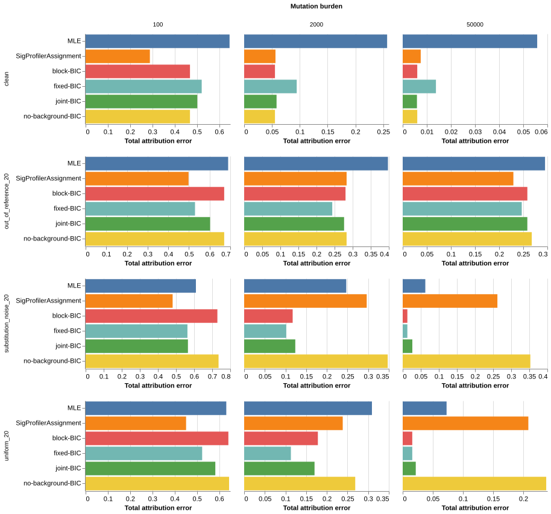

## Decision and findings



## Compare background policies

All sparse policies use constrained multinomial MLE for their weights.
BIC compares `2 * NLL + d * log(N)` using count-scale negative log likelihood.
`N` denotes mutation burden.
`d` counts retained components minus one for the simplex constraint.

- `fixed-BIC` retains all six background components during known-signature selection.
- `no-background-BIC` excludes the background components.
- `joint-BIC` allows individual background and known-signature removals and additions.
- `block-BIC` compares complete fixed-background and no-background models.
- `MLE` fits the complete reference without subset selection.
- `SigProfilerAssignment` supplies the external comparator.

Fixed-background BIC already counts all six background components.
However, its background cost remains constant across known-signature subsets.
Joint selection makes that cost depend on the retained background components.
Block selection compares the entire background cost against zero background cost.
Neither approach places a prior on background mass.

The search starts from the full model and removes numerical zeros before discrete selection.
Backward elimination and forward additions accept only criterion improvements.
This search reaches a local subset optimum.
It does not guarantee the best subset across all possible models.
Correlated signatures and mixture boundaries limit conventional BIC interpretations.
A small BIC does not establish biological truth.

## Benchmark design

Each panel contains 768 simulated profiles across eight cancer exposure distributions.
Each combination contains eight draws per cancer, three mutation burdens, and four conditions.
The burdens are 100, 2,000, and 50,000 mutations.
Conditions include clean profiles, out-of-reference signatures, uniform background, and substitution-specific background.
Each non-clean condition replaces 20% of known-signature mass.
Two additional signatures supply the out-of-reference condition.
Generation uses COSMIC v3.3.1; fitting uses COSMIC v3, matching the preceding benchmark.
Thus, even clean profiles can contain reference-version mismatch.
The two background controls directly match the fitted background family.
For out-of-reference profiles, `null_truth` denotes missing signature mass, not a generated context-independent background.

The paired panel reuses the previous reassessment's fresh inputs exactly.
The fresh panel uses seed `202610273` with the same empirical exposure distributions.
These fresh draws do not constitute independent patient validation.
The default decision uses these comparisons; a later external cohort must test generalization.
Both panels compare all six configurations, totaling 9,216 fits.
The runner records the configuration, source hashes, input hashes, and software versions before fitting.

Total attribution error retains the preceding reassessment's `aggregate_null_tae` metric.
It combines unthresholded known-signature error with aggregate background-mass error, then divides by two.
The report also includes `paper_tae`, which applies the existing ten-mutation reporting threshold.
This thresholded metric compares known-signature estimates against the full generating-signature truth.
The metrics can rank low-burden fits differently.
The decision considers both metrics and does not equate thresholded reporting with complete attribution.
The report also records background mass, aggregate background error, active signatures, and reconstruction cosine.
Bootstrap intervals resample profiles within each cancer distribution 2,000 times.
They describe simulation variation within this design.
They do not represent clinical population confidence intervals.
Concurrent workers limit direct interpretation of runtime differences.

## Fresh clean profiles



## Paired clean profiles



## All conditions



[Open the interactive chart](background-results/interactive.html).
[Download all summary metrics](background-results/summary.tsv).
[Download paired differences and intervals](background-results/paired-differences.tsv).

## Verification and reproduction

The verifier independently recalculates final-model likelihood certificates and BIC dimensions.
It checks probability constraints, finite estimates, source hashes, and sampled metric arithmetic.
It also compares repeated baseline results against the previous reassessment.

Install the dependency versions recorded in each panel's `specification.json`.
Prepare the SigFitTest checkout at commit `e94bac6e9b04fb13500d1904b5e0e8d58b00d8ad`.
Use an isolated checkout without existing phase output directories.
Retain the frozen source directory and the preceding paired-input artifacts.
Restore frozen fitter and runner sources when reproducing the original source hashes.

```sh
python analysis/signature-benchmark-2026/run_background_benchmark.py paired
python analysis/signature-benchmark-2026/run_background_benchmark.py fresh
python analysis/signature-benchmark-2026/verify_background_benchmark.py
python analysis/signature-benchmark-2026/summarize_background_benchmark.py
quarto render analysis/signature-benchmark-2026/background-report.qmd
```

Existing output directories prevent accidental evidence replacement.
Use an isolated checkout and fresh output directories for a repeat run.
The frozen source directory records the implementation used for this benchmark.
The artifact manifest records subsequent interface and documentation changes separately.

[Read the fitting guide](../../docs/sparse-signatures.md).
[Read the preceding likelihood reassessment](repaired-report.html).
The preceding report retains its historical default description.
