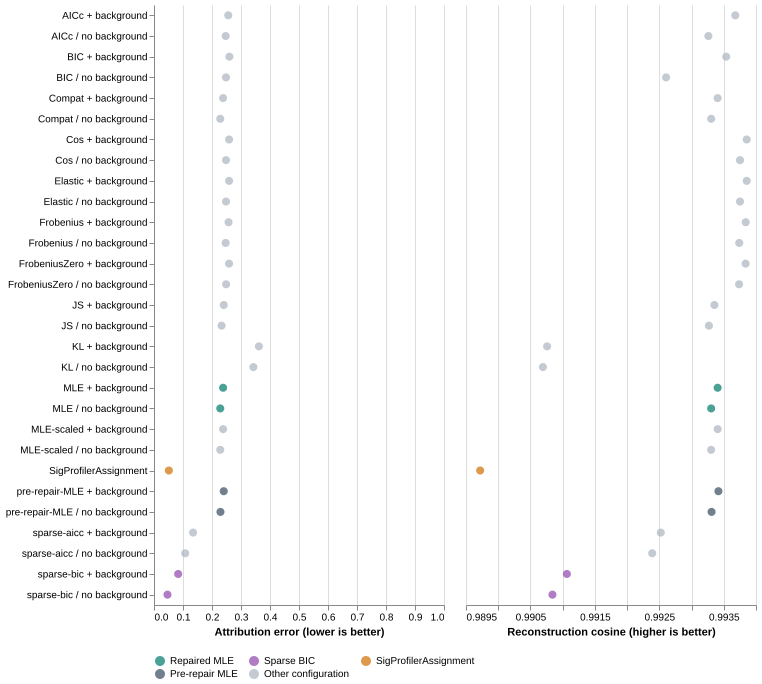

## What changes

The implementation now validates likelihood solutions instead of relying on the optimizer's status alone.
Python, CLI, and web interfaces share the `MLE` fitting-method default.
The Python default changes from `Frobenius`; callers can still select that objective explicitly.
Signature catalog choices remain separate from fitting-method choices.

The fitting boundary normalizes each positive signature column and rejects invalid counts or signature entries.
The likelihood solver uses a smooth per-mutation objective, analytic derivatives, and explicit simplex equality.
It rejects observed channels outside the complete reference's support, including enabled background components.
Zero probability in an observed channel has infinite negative log likelihood.
The objective preserves very small positive probabilities instead of replacing them with a fixed probability floor.

Each candidate must satisfy nonnegativity, unit total weight, and a convex optimality bound.
The bound limits remaining negative log likelihood improvement to `2e-5` nats per mutation.
It does not bound exposure uncertainty or biological attribution error.
The solver can normalize a candidate before checking its feasibility and optimality.
An unsuccessful solver status can therefore produce an accepted, independently certified candidate.
A successful status cannot bypass certification.

After an uncertified attempt, the solver retries within the likelihood model.
After three unsuccessful attempts, it raises `RuntimeError` instead of returning NNLS as MLE.
NNLS remains an initialization option, not a replacement estimator for MLE or sparse refits.
The sparse methods use the same certified likelihood solver for every candidate subset.
Every method reports `LogLik` from the original counts, omitting the constant multinomial coefficient.

`MLE-scaled` and `Compat` now use the repaired MLE solver.
The panel retains their labels to make comparisons with the earlier benchmark explicit.
They no longer represent distinct fitting objectives.
Legacy non-MLE objectives retain their own implementations and explicit normalized-NNLS fallback diagnostics.

## Regression coverage and package checks

The full suite passes 497 tests with 68.87% coverage.
The change adds 42 regression cases across numerical and interface tests.
These cases cover the analytic optimum, analytic gradients, and the former simplex-boundary discontinuity.
They also cover count scaling, solver-status errors, likelihood retries, invalid probabilities, column normalization, and likelihood units.
CLI and web tests verify shared defaults and explicit failure propagation.
An additional test preserves correct gradients for extremely small positive probabilities.

One existing CLI snapshot changes because the corrected likelihood optimum changes its fitted exposure and rounded mutation count.
That test now also checks the optimality certificate and absence of fallback.
Four suite warnings come from numerical differentiation in legacy non-MLE benchmark objectives.

The strict Sphinx build passes.
The wheel installs in a separate environment outside the checkout.
Its smoke checks cover the offline demo, homepage, static asset, analytic likelihood optimum, and count-scaling invariance.

## Benchmark design

The paired panel reuses all 768 earlier evaluation profiles with their original channel order and reference matrix.
It contains eight cancers, three mutation burdens, and four conditions.
The burdens are 100, 2,000, and 50,000 mutations.
The conditions are clean profiles, 20% omitted-signature contribution, 20% uniform contamination, and 20% substitution-specific contamination.
Each condition and burden contains 64 profiles, with eight profiles per cancer.
The runner reevaluates all 27 configurations, producing 20,736 fits.
It reruns SigProfilerAssignment with the same custom reference and canonical channel alignment.
Archived MLE results provide the paired pre-repair comparison.

The fresh panel uses seed `20261027` and new mutation-count draws.
It contains another 768 profiles with the same balanced design.
The runner evaluates the same configurations and both archived MLE background settings, producing 22,272 fits.
The archived MLE source reproduces the pre-repair implementation for these new profiles.

The earlier tuning selection remains frozen at sparse BIC.
This assessment performs no new criterion selection or threshold tuning.
The paired data inform the repair, so the fresh panel provides the more relevant generalization check.
Both panels share empirical exposure distributions; neither constitutes independent patient validation.
The panels run concurrently, so recorded runtimes do not support controlled speed comparisons with earlier runs.

The runner checks the upstream commit and ten input-file hashes before generation.
Each phase records source hashes, environment versions, and the frozen selection record before fitting starts.
Historical source snapshots and manifest relocations preserve the earlier evidence without changing its hashes.

## Results and interpretation

Attribution error equals half the summed absolute errors in known-signature weights and total background mass.
For omitted signatures, the background target aggregates their generating contributions.
This metric uses the unthresholded fitted weights.
Zero indicates exact recovery; one indicates nonoverlapping normalized mixtures.
It measures mixture-weight error, not individual mutation assignments.

An active known signature receives at least ten fitted mutations.
This reporting threshold does not determine the likelihood fit or replace sparse subset selection.
A fixed ten-mutation threshold corresponds to different weight thresholds at different mutation burdens.
Reconstruction cosine compares the reconstructed profile with observed counts, including their sampling noise.



### Fresh clean profiles



### Paired clean profiles



### All configurations

[Open the interactive comparison](repaired-results/figures/interactive.html) to change panel, condition, or mutation burden.
The reconstruction axis excludes zero so that small differences remain visible.
Reconstruction and attribution measure different outcomes.

## Interpret uncertainty and background

[Paired differences](repaired-results/paired-differences.tsv) use 2,000 bootstrap resamples within each cancer stratum.
Each cancer contributes equal weight.
Negative differences favor the first named method.
These intervals describe Monte Carlo variation conditional on the empirical exposure distributions.
They do not establish clinical uncertainty or population-level performance.

Two contamination controls deliberately match the context-independent background basis.
Their results do not establish recovery of arbitrary unknown processes or sequencing artifacts.
Background weights can also absorb genuine known-signature contributions.
Sparse solutions therefore need attribution checks even when reconstruction appears adequate.

## Reproduce or inspect

Use the pinned dependencies in `requirements-benchmark.txt`.
Run `python run_repaired_benchmark.py paired` and `python run_repaired_benchmark.py fresh`.
The runner refuses to overwrite an existing phase directory.
Run `python verify_repaired_benchmark.py` to check provenance, constraints, certificates, and metric arithmetic.
Run `python summarize_repaired_benchmark.py`, then `quarto render repaired-report.qmd`.

- [Verification record](repaired-results/verification.json)
- [Paired specification](repaired-results/paired/specification.json)
- [Fresh specification](repaired-results/fresh/specification.json)
- [Summary table](repaired-results/summary.tsv)
- [Likelihood fitting guide](../../docs/likelihood-fitting.md)
- [Original likelihood audit](likelihood-audit.html)

The original audit scripts describe the pre-repair source snapshot.
Use that snapshot when reproducing the original defects.
The historical verification scripts resolve the archived source hashes after production changes.
