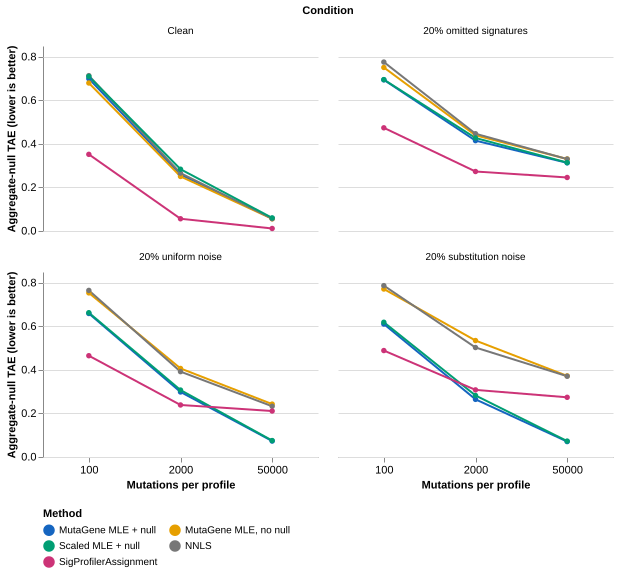

## Follow-up assessment

The [sparse-selection assessment](sparse-report.html) expands this comparison to every distinct existing objective and two new subset-selection methods.
It uses separate tuning and evaluation simulations.
The original results below describe the tested MLE configurations, not all MutaGene methods.

## Decision

MutaGene's null signatures help with noise that matches their basis.
They do not provide a general solution for unknown mutational processes.
SigProfilerAssignment performs better on clean profiles and omitted-signature contamination in this controlled benchmark.
The results support an optional comparator workflow and explicit diagnostics.
They do not justify a universal method ranking or a clinical claim.

## Main comparison



[Open the interactive Vega-Lite figure](figures/interactive.html).
The interactive figure includes tooltips and contains its JavaScript dependencies.
[Download the Vega-Lite specification](figures/attribution.vl.json).

At 50,000 mutations, the mean errors are:

| Condition | MLE + null | MLE, no null | Scaled MLE + null | NNLS | SigProfilerAssignment |
|---|---:|---:|---:|---:|---:|
| Clean | 0.058 | 0.056 | 0.060 | 0.057 | 0.012 |
| 20% omitted signatures | 0.313 | 0.331 | 0.314 | 0.330 | 0.246 |
| 20% uniform noise | 0.073 | 0.243 | 0.076 | 0.233 | 0.211 |
| 20% substitution noise | 0.071 | 0.373 | 0.073 | 0.371 | 0.274 |

At 2,000 mutations, clean-data error is 0.259 for MLE + null and 0.056 for SigProfilerAssignment.
At 100 mutations, those errors rise to 0.700 and 0.352.
Low burden limits attribution reliability even when a method reconstructs the observed profile well.

### What the context-independent background recovers

MutaGene adds six components that the API calls null signatures.
They form a fitted context-independent background model, not a Bayesian prior.
Each signature covers one substitution type with equal weight across its sixteen sequence contexts.
Their mixture includes uniform SBS96 noise and substitution-specific context-independent noise.
It does not include arbitrary unknown signatures.

| Condition | True unknown mass | Mean fitted null mass, 100 mutations | Mean fitted null mass, 50,000 mutations |
|---|---:|---:|---:|
| Clean | 0.00 | 0.065 | 0.0045 |
| Omitted signatures | 0.20 | 0.075 | 0.0246 |
| Uniform noise | 0.20 | 0.115 | 0.1704 |
| Substitution noise | 0.20 | 0.192 | 0.1731 |

Null weights do not directly estimate the total unknown-process fraction.
Known flat signatures can compete with null components.
Sampling variation can also produce nonzero null weights in clean profiles.
The matched noise controls favor a basis that explicitly represents those controls.
Real sequencing artifacts require separate assessment.

### Reconstruction does not establish attribution

At 50,000 mutations, clean-data known-signature F1 is 0.310 for MLE + null and 0.982 for SigProfilerAssignment.
Both methods achieve very high reconstruction cosine similarity.
MutaGene's reconstruction is slightly closer, despite its less accurate signature attribution.
The benchmark therefore preserves attribution metrics alongside reconstruction metrics.

### Numerical behavior

Across all conditions at 50,000 mutations, the baseline null-enabled optimizer fails in 68.1% of profiles.
The baseline silently returns normalized NNLS estimates after failure.
The updated implementation emits a warning and exposes optimizer status in diagnostics.

The scaled objective divides negative log likelihood by mutation burden.
Its optimum remains mathematically identical, but optimizer stopping tolerances change their practical effect.
All 4,800 scaled-MLE fits converge in this experiment.
Mean high-burden fit times fall from approximately 0.33–0.50 seconds to 0.018–0.028 seconds across conditions.
These measurements describe this machine and concurrent execution.
They do not represent a controlled cross-package speed ranking.

Scaled MLE does not consistently improve attribution error.
The CLI therefore offers `--method MLE-scaled` as an experimental option.
The default remains `MLE`.

## Design

The assessment adapts [Medo, Ng, and Medova (2024)](https://doi.org/10.1038/s41467-024-53711-6).
It uses [SigFitTest](https://github.com/8medom/SigFitTest) commit `e94bac6e9b04fb13500d1904b5e0e8d58b00d8ad`.
This is reduced replication of the published design with two additional noise controls.
It is not a complete reproduction of the paper's experiments or rankings.

The cancer panel contains Liver-HCC, Stomach-AdenoCA, Head-SCC, ColoRect-AdenoCA, Lung-AdenoCA, Skin-Melanoma, Lymph-BNHL, and CNS-GBM.
Each cancer contributes 25 sampled empirical exposure profiles per replicate.
Two replicates and three burdens yield 1,200 clean profiles.
Four conditions yield 4,800 profiles in total.
The seed is `20261023`.

The generator removes expected signature contributions below ten mutations, then normalizes the remaining contributions.
It uses COSMIC v3.3.1 signatures to generate counts.
All methods fit the same 67-signature COSMIC v3 reference.
The generator normalizes each reference column and samples individual mutation channels.

The omitted-signature condition adds two randomly chosen signatures with 10% mass each.
Candidates comprise SBS10c, SBS10d, and SBS86–SBS95.
The uniform-noise control assigns 20% mass equally across 96 channels.
The substitution-noise control assigns 20% through the six null components.
Its component weights are `[0.05, 0.10, 0.60, 0.10, 0.10, 0.05]`.
Both noise controls retain 80% known-signature mass.

### Methods

- **MLE + null:** the frozen production fitter with six null components.
- **MLE, no null:** the same fitter without those components.
- **NNLS:** a nonnegative least-squares baseline without post-fit renormalization.
- **Scaled MLE + null:** the baseline objective divided by mutation burden.
- **SigProfilerAssignment:** version 1.1.5 with the same custom known-signature reference.

The local methods use identical channel-label mappings.
SigProfilerAssignment reorders sample rows internally but preserves custom reference row order.
The comparator adapter therefore aligns the reference to its canonical order before fitting.
The final comparator results replace an invalid preliminary run with mismatched row order.
That preliminary run contributes no reported metrics.

The frozen fitter preserves the original numerical behavior.
It remains separate from the updated production module's diagnostics and optional scaled method.
[Provenance](results/provenance.json) records the baseline commit and fitter hash.

## Metrics and uncertainty

For known signatures $K$, aggregate-null total attribution error is:

$$
E_{\mathrm{null}} = \frac{1}{2}\left(\sum_{j\in K}|\hat w_j-w_j|+|\hat u-u|\right).
$$

Here, $u$ denotes contamination mass and $\hat u$ denotes fitted null mass.
Methods without null components have $\hat u=0$.
The metric compares raw exposure fractions without thresholding or renormalization.
It credits aggregate mass accounting, not identification of an omitted signature.

`paper_tae` implements half the exposure L1 distance after the ten-mutation fitted-contribution cutoff.
Use this metric for clean and omitted-signature conditions.
It does not include a separate truth category for the two noise controls.
Do not interpret their `paper_tae` values as a complete mass-accounting error.

Known-signature F1 compares the fitted reference signatures with the known truth subset after the same cutoff.
Omitted signatures do not enter its candidate set.
The report also preserves false-positive mass, false-negative mass, null error, and reconstruction similarity.

Paired comparisons use the same synthetic profiles for both methods.
Each 95% interval uses 2,000 bootstrap resamples within each cancer stratum.
The analysis gives each cancer equal weight.
These intervals describe Monte Carlo variation conditional on the eight empirical distributions.
They do not quantify uncertainty across all cancer populations.
The design reuses empirical exposure draws across conditions and burdens.
Consequently, separate cells do not represent independent biological cohorts.

[Paired differences and intervals](results/paired_differences.tsv) report comparator error minus MLE + null error.
Negative values favor the comparator.
[Per-profile metrics](results/metrics.tsv) support cancer-specific inspection.

## Software changes and evidence boundaries

The implementation adds an offline demo, gzip/stdin handling, labelled matrices, optimizer diagnostics, and deterministic bootstrap seeds.
It repairs wheel assets and prevents silent pooling of multisample VCFs.
It corrects t-based bootstrap spread estimates from replicate SEM to bootstrap standard deviation.
The percentile method remains the default.
The t-based option remains approximate; this correction does not establish confidence-interval coverage.

The web interface identifies unsupported classification explicitly and runs actual motif analysis.
The COSMICv3 label states the bundled snapshot date.
DVC, Nextflow, Snakemake, and R examples share the same matrix boundary.
These execution checks establish software behavior, not scientific accuracy on real cohorts.

The optional AlphaMissense cache supports hg19 and hg38 genomic lookups.
A live hg38 download matches the pinned size and MD5 checksum.
A tabix lookup at chr1:69094 G>T returns score 0.2937 for ENST00000335137.4 V2L.
Missing alleles and transcript mismatches remain explicit.
AlphaMissense annotations do not alter B-scores, q-values, or driver labels.
See the [annotation guide](../../docs/alphamissense.md) for the planned combined-model evaluation.

## Relevant developments through October 2026

The [2025 thirteen-tool benchmark](https://doi.org/10.1093/bib/bbaf042) reinforces the need for attribution-focused comparisons.
[MuSiCal](https://doi.org/10.1038/s41588-024-01659-0) provides another methodological candidate.
Its repository license restricts use; this assessment neither integrates nor benchmarks it.
[BASCULE](https://doi.org/10.1186/s13059-025-03835-9) adds biological priors and multiple signature types.
Its journal volume is 2026; online publication occurs in December 2025.
[StarSignDNA](https://doi.org/10.1093/nargab/lqaf181) addresses low-mutation contexts.
The [2026 mSigSDK study](https://doi.org/10.1186/s12859-026-06681-z) highlights browser-native signature computation.
These papers motivate future comparisons; they do not supply unmeasured MutaGene results.

For driver interpretation, [the 2024 AlphaMissense assessment](https://doi.org/10.1016/j.jmb.2024.168644) distinguishes pathogenicity from cancer-driver prediction.
[The 2026 MutaPheno study](https://doi.org/10.1073/pnas.2524289123) motivates evaluating molecular features with held-out proteins.
A combined MutaGene model requires its own independent evaluation.

## Reproduce the assessment

Create a separate environment with the exact versions in `requirements-benchmark.txt`.
Install this MutaGene checkout without changing that environment's pinned dependencies.
Use a fresh output directory because the runner overwrites its selected outputs.
From `analysis/signature-benchmark-2026`, run:

```sh
git clone https://github.com/8medom/SigFitTest /tmp/SigFitTest
git -C /tmp/SigFitTest checkout e94bac6e9b04fb13500d1904b5e0e8d58b00d8ad
OPENBLAS_NUM_THREADS=1 OMP_NUM_THREADS=1 python run_benchmark.py \
  --source /tmp/SigFitTest --output results-reproduced \
  --samples 25 --replicates 2 --workers 4 --spa
python summarize.py
quarto render report.qmd
```

`summarize.py` reads the committed `results` directory.
To regenerate figures from another run, first select that run's outputs explicitly.
[Inputs](results/inputs.npz), [estimates](results/estimates.npz), and [sample metadata](results/samples.tsv) preserve the benchmark state.
The output manifest provides SHA256 hashes for the evidence bundle.
