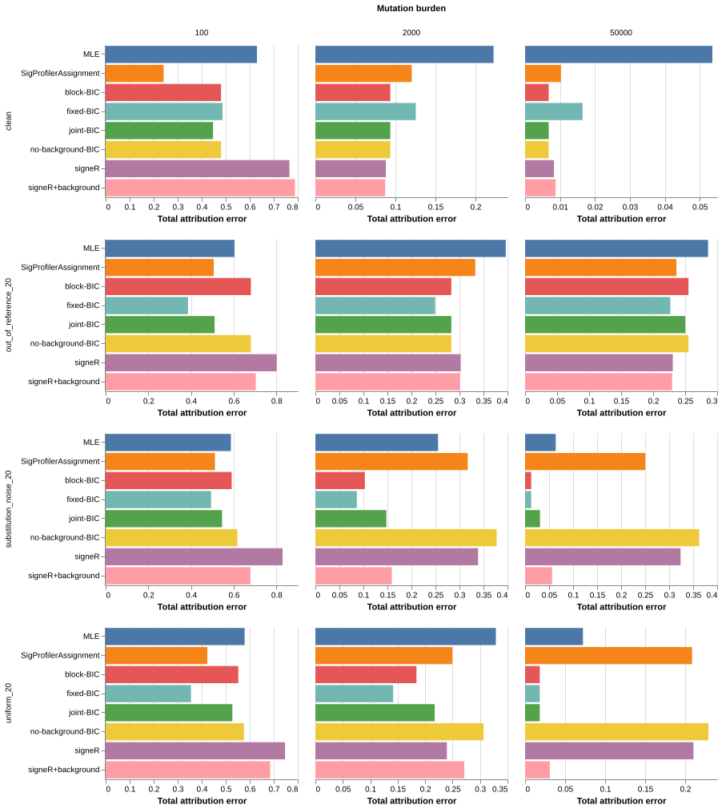

## Results and interpretation



## What differs between the methods

signeR supports both signature discovery and exposure estimation against a fixed catalog.
Therefore, discovery versus attribution does not fully distinguish signeR from MutaGene.
Its documented `fixedP=TRUE` mode supplies the relevant comparator here.
Its rank-selection BIC does not perform MutaGene's per-profile known-signature subset search in this mode.
[Official signeR vignette](https://bioconductor.org/packages/release/bioc/vignettes/signeR/inst/doc/signeR-vignette.html).

| Aspect | MutaGene sparse BIC | signeR configuration here |
|---|---|---|
| Signature reference | Fixed known catalog | Same fixed catalog |
| Weight inference | Constrained multinomial MLE | Gibbs sampling under the package's Bayesian count model |
| Sparsity | Discrete subset search with BIC | Native posterior exposure estimates |
| Hyperparameters | No exposure prior | Native 2.14.0 hyperparameter defaults; no benchmark tuning |
| Background | Existing fixed, joint, and block policies | Separate run with the same six components appended to the reference |
| Uncertainty | Separate bootstrap analysis | Posterior draws and chain diagnostics |
| Opportunities | No explicit opportunity matrix in this panel | Unit opportunities to match the panel's channel-probability reference |

The signeR sampler models counts through Poisson intensities.
MutaGene's likelihood conditions on the observed mutation total.
Conditional on their total, independent Poisson counts follow a multinomial distribution.
The distribution names alone therefore do not establish an algorithmic advantage.
Priors, model selection, background treatment, and numerical behavior matter to this comparison.

signeR also supports explicit mutational opportunity matrices.
Opportunity awareness, known-catalog attribution, and BIC are therefore not new capabilities relative to signeR.
A calibrated context-independence null remains a separate proposed extension.
This benchmark does not establish novelty or implement that proposed null-calibration procedure.

## Matched evaluation scope

The extension uses 96 profiles from the preceding fresh 768-profile panel.
It selects `sample_index == 0` within every cancer, condition, and burden combination.
Selection does not depend on any method's attribution accuracy.
All eight cancer exposure distributions and all twelve condition/burden combinations remain represented.
Each condition/burden cell contains eight profiles.

The comparison contains the six preceding configurations and two signeR configurations.
Every method uses the same 96 profiles and the same 67-signature reference.
This experiment tests broad-catalog attribution without tissue-specific reference filtering.
The report recalculates baseline summaries on this subset.
It does not compare a signeR subset mean against another method's full-panel mean.

The primary signeR comparison contains 192 fits.
Twenty-four additional fits repeat both signeR configurations across all twelve Liver-HCC condition/burden combinations.
Those independent chains assess sampling stability.
They do not add independent biological profiles to the accuracy comparison.

The preceding panel generates profiles from COSMIC v3.3.1 and fits COSMIC v3.
It includes clean profiles, 20% out-of-reference signatures, 20% uniform background, and 20% substitution-specific background.
This extension inherits those assumptions and their limitations.
It does not test de novo signature discovery or real-data opportunity correction.

## Native settings and exposure conversion

The runner uses unmodified signeR 2.14.0 from Bioconductor release 3.23.
The installed package identifies upstream commit `9a035cd1b9eb57eaf275392e58a71b695ca9bdd3`.
Each profile receives an independent fixed-catalog fit.

Settings use `fixedP=TRUE`, 10,000 burn-in iterations, and 2,000 retained draws.
The runner retains the package's native hyperparameter defaults with `estimate_hyper=FALSE`.
Thus, this configuration does not estimate shared hyperparameters across benchmark profiles.
The runner supplies deterministic, distinct seeds for every fit.

The primary estimate uses native `Median_exp`, divided by its total to obtain relative exposure weights.
The outputs also retain every native median count and its total relative to the observed burden.
Separate raw-scale metrics show the effect of this normalization.
This conversion avoids silently equating freely estimated Poisson intensity with constrained total mutation mass.

`signeR+background` appends MutaGene's six context-independent components to the fixed reference.
This configuration uses signeR's normal inference machinery for all columns.
It does not add a native null test or MutaGene's subset-selection algorithm to signeR.

## Accuracy and reconstruction





[Open the interactive chart](signer-results/interactive.html).
[Download all matched metrics](signer-results/metrics.tsv).
[Download per-cancer summaries](signer-results/cancer-summary.tsv).
[Download paired differences](signer-results/paired-differences.tsv).

Total attribution error uses the preceding report's `aggregate_null_tae` metric.
It combines unthresholded known-signature error and aggregate background-mass error, then divides by two.
`paper_tae` retains the ten-mutation reporting threshold and compares against the complete generating-signature truth.
The report includes both metrics because they can rank low-burden estimates differently.

Descriptive bootstrap intervals resample the eight cancer groups, retaining each group's twelve profiles together.
Only one simulated profile represents each cancer/condition/burden cell.
These intervals do not establish clinical population uncertainty or robust superiority across independent cohorts.

## Sampling stability and runtime

Every fit records single-chain split Rhat, effective sample sizes, and Monte Carlo standard errors.
Independent chain comparisons additionally report two-chain diagnostics and exposure differences.
The runner retains posterior draws for the 48 fits in the independent-chain subset.
Every fit retains its diagnostic summary.
The report identifies active components with the same ten-mutation threshold used elsewhere.
A profile with no active components has no active-component convergence summary.

Numerical completion does not establish MCMC convergence.
Diagnostics use the posterior package's rank-normalized split and folded-split Rhat.
[Diagnostic definitions](https://mc-stan.org/posterior/reference/rhat.html).
The report retains all completed estimates and discloses poor diagnostics instead of excluding difficult profiles.
[Download independent-chain comparisons](signer-results/chain-stability.tsv).

Runtime measurements include different execution dates and concurrent workloads.
They describe these runs and do not constitute a controlled hardware speed benchmark.

## Reproduction and verification

Install the R versions and package versions recorded in `signer-results/session-info.txt` and `r-packages.csv`.
The runner requires signeR 2.14.0 and the posterior diagnostics package.
Retain the preceding `background-results/fresh` artifacts.
Clone the pinned upstream source into `/tmp/mutagene-signer-source` before running the preparation script.
Use an isolated checkout without an existing `signer-results` directory.

```sh
python analysis/signature-benchmark-2026/prepare_signer_benchmark.py
Rscript --vanilla analysis/signature-benchmark-2026/run_signer.R \
  analysis/signature-benchmark-2026/signer-results /path/to/R/library 8
Rscript --vanilla analysis/signature-benchmark-2026/check_signer_chains.R \
  analysis/signature-benchmark-2026/signer-results /path/to/R/library
python analysis/signature-benchmark-2026/score_signer_benchmark.py
python analysis/signature-benchmark-2026/summarize_signer_benchmark.py
quarto render analysis/signature-benchmark-2026/signer-report.qmd
```

The verifier checks frozen input hashes, sample identity, signature order, exposure normalization, and complete matched coverage.
The artifact manifest records the new outputs without modifying previous benchmark evidence.
The adapter tests cover alignment failures, normalization, task mismatches, and sampler errors.

The finalized bundle includes 518 passing tests and successful documentation, distribution, and installed-wheel checks.
[Validation records](signer-results/validation.json) identify the commands and retained logs.
[Artifact manifest](signer-results/artifact-manifest.json) records file sizes and SHA-256 hashes.
Verify the completed bundle and all five preceding manifests with this command:

```sh
python analysis/signature-benchmark-2026/verify_signer_bundle.py
```

[Preceding background assessment](background-report.html).
[Official signeR source](https://code.bioconductor.org/browse/signeR/).
