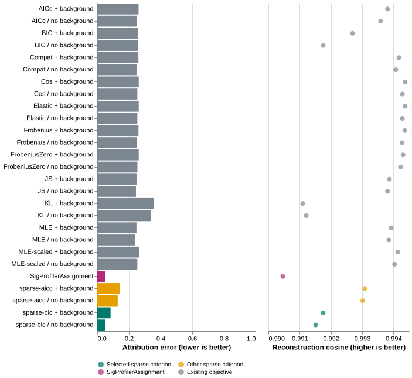

## What this assessment tests

This assessment tests whether explicit signature subset selection improves attribution without discarding useful background modeling.
It also compares every distinct existing fitting objective, addressing the earlier report's narrow focus on MLE.
The experimental methods remain opt-in.
The default `MLE` method remains unchanged.

The earlier report uses 4,800 profiles to diagnose over-attribution and background behavior.
This follow-up uses new simulations for tuning and evaluation.
It does not reuse the earlier profiles to select a criterion or report final evaluation estimates.

## Background is a fitted component, not a prior

For a known-signature matrix $S$, exposures $w$, and background weights $u$, the fitted channel probabilities are:

$$
q_c = \sum_k w_k S_{ck} + \sum_{s=1}^{6} u_s B_{cs},
\qquad w_k,u_s\geq0,\quad \sum_k w_k+\sum_su_s=1.
$$

Each $B_{cs}$ equals $1/16$ within substitution class $s$ and zero outside that class.
The resulting background ignores flanking sequence within each substitution class.
Its weights can absorb sampling error, model mismatch, or genuine context-independent signal.
They do not establish technical noise or identify arbitrary omitted processes.

This model contains no probability distribution over the weights themselves.
Therefore, it does not apply a Bayesian background prior.
A shrinkage prior on background mass would require a separate model and evaluation.
Existing API fields retain `null_weight` and `null_components` for compatibility.
This report describes their statistical role as context-independent background.

## Sparse selection

The new methods refit a multinomial likelihood under simplex constraints for each candidate subset.
They use a burden-scaled objective and its analytic gradient for numerical optimization.
Information criteria use the unscaled negative log likelihood.

Backward elimination tests each removable known signature.
Forward additions reconsider excluded known signatures after backward elimination stops improving the criterion.
The search stops at a local subset optimum.
It does not guarantee the globally optimal subset.

The background-enabled search retains all six background components as nuisance parameters.
It permits zero known signatures when background explains the profile.
A model with $k$ known signatures has $k+5$ nominal dimensions with background, or $k-1$ without background.
Correlations and mixture boundaries limit the usual information-criterion interpretation.
Sparse solutions therefore require empirical validation rather than an assumption that fewer signatures means better attribution.

## Separate tuning and evaluation

The tuning simulation contains 192 profiles across eight cancer types, three burdens, and four conditions.
The seed is `202610231`.
It compares `sparse-aicc` and `sparse-bic`, each with and without background, for 768 fits.
The selection rule minimizes mean aggregate-null attribution error across all tuning cells and both background settings.
A candidate must complete every tuning fit without failure.

Tuning selects **sparse BIC**: mean error 0.292 versus 0.327 for sparse AICc.
Both candidates complete tuning without failed fits.
The runner records the selected criterion and source hash before generating evaluation profiles.
[The frozen selection record](sparse-results/selection.json) preserves this decision.

The evaluation uses seed `202610232` and eight profiles per cancer, burden, and condition.
It contains 768 profiles, including 64 profiles per condition and burden.
The runner evaluates 27 configurations, yielding 20,736 fits.
These configurations comprise eleven existing objectives, two sparse methods, and SigProfilerAssignment.
Every MutaGene objective uses both background settings.
SigProfilerAssignment uses its default selection settings with the same custom reference matrix.
Its automatic SBS1/SBS5 handling differs from MutaGene's six context-independent background components.

The existing objectives are `MLE`, `MLE-scaled`, `Frobenius`, `FrobeniusZero`, `Cos`, `Elastic`, `KL`, `JS`, `AICc`, `BIC`, and `Compat`.
Aliases such as `mlez` do not add distinct objectives when the background flag already specifies the configuration.
The existing `AICc` and `BIC` optimize discontinuous penalties directly with SLSQP.
The new methods instead compare explicit subsets after likelihood refits.
The existing `Elastic` implementation uses a signature-count penalty; it does not implement a conventional convex elastic net.

The simulations share empirical exposure distributions with the earlier assessment.
New random draws do not constitute independent patient validation.
All comparisons preserve the same known-signature reference and channel alignment.
Corresponding known columns in the generating and fitting catalogs differ by at most 0.00000031 in L1 distance.
These rounding-scale differences do not explain the earlier attribution gap.
The runner records unresolved failures and existing methods' NNLS fallbacks separately.

## Attribution and reconstruction together

The figure shows all 27 configurations for clean profiles with 2,000 mutations.
The interactive version lets you select another condition or burden.
Attribution error compares estimated weights with simulation truth.
Reconstruction cosine compares reconstructed channel frequencies with observed counts.
The two metrics answer different questions.
The reconstruction axis excludes zero and adjusts to the selected profiles, making small differences visible.

[Open the interactive comparison](sparse-results/figures/interactive.html).

### Focused clean-profile comparison



### Interpretation



## Uncertainty and limitations

[Paired differences](sparse-results/paired-differences.tsv) compare sparse BIC with MLE and SigProfilerAssignment on identical evaluation profiles.
Negative differences favor sparse BIC.
Each interval uses 2,000 bootstrap resamples within each cancer stratum, with equal cancer weighting.
These intervals describe Monte Carlo variation conditional on the eight empirical exposure distributions.
They do not establish population-level or clinical uncertainty.
The 64 profiles per condition and burden limit precision.

The uniform and substitution-specific controls deliberately match the background basis.
Their results do not establish recovery of arbitrary sequencing artifacts or unknown biology.
Low mutation burdens limit signature identification even when a sparse solution appears plausible.
Known-signature F1 excludes the deliberately omitted signatures from its candidate set.

Legacy optimizer fallback rates matter when comparing named objectives.
A failed fit that returns normalized NNLS does not establish successful optimization of its requested objective.
The sparse methods stop on unresolved refit failures instead of substituting another estimator.

## Reproduce or inspect

Use the pinned environment in `requirements-benchmark.txt`.
Run `run_sparse_benchmark.py tune`, then `run_sparse_benchmark.py evaluate`.
The runner requires the pinned SigFitTest source and refuses to overwrite an existing phase directory.
A fresh run therefore needs a fresh output location or checkout.
Do not delete or replace the original evaluation when experimenting with new settings.

Run `summarize_sparse.py` after evaluation completes.
Run `verify_sparse.py` to check source hashes, pairings, constraints, and sampled metric arithmetic.
Render this document with `quarto render sparse-report.qmd`.
The phase directories preserve inputs, estimates, specifications, and per-profile metrics.
The source hashes identify the exact fitter definitions.

See the [sparse-fitting guide](../../docs/sparse-signatures.md) for CLI usage.
The [extended-context logo proposal](../../docs/extended-context-logos.md) describes a separate future feature.
